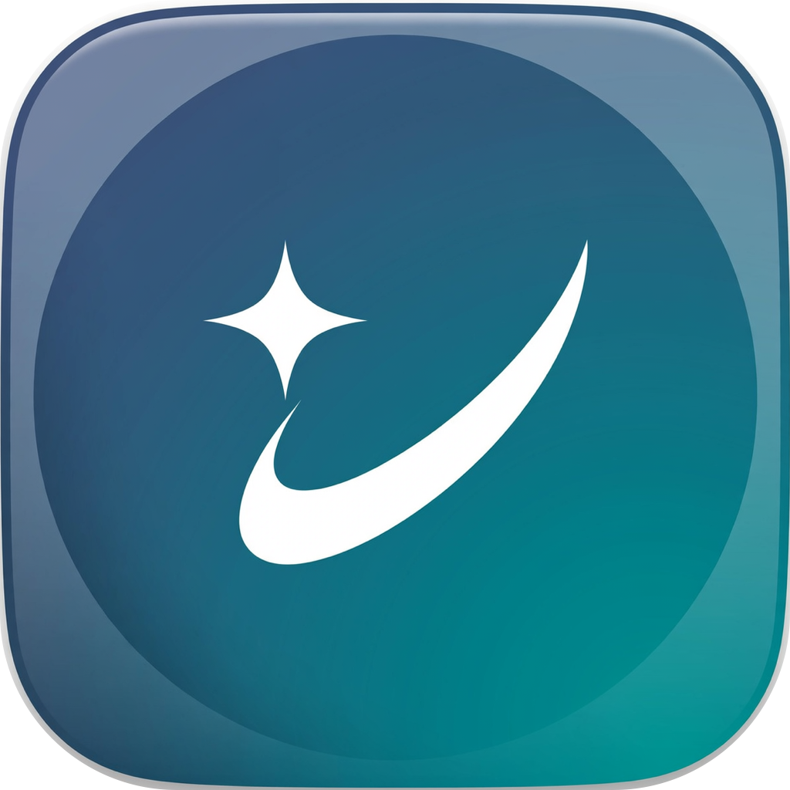
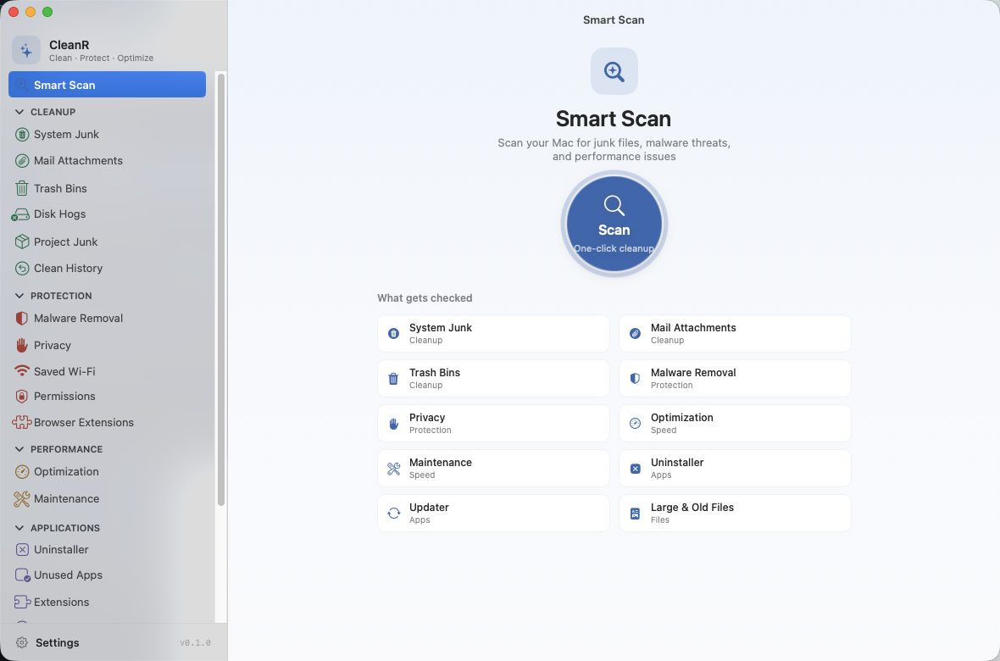
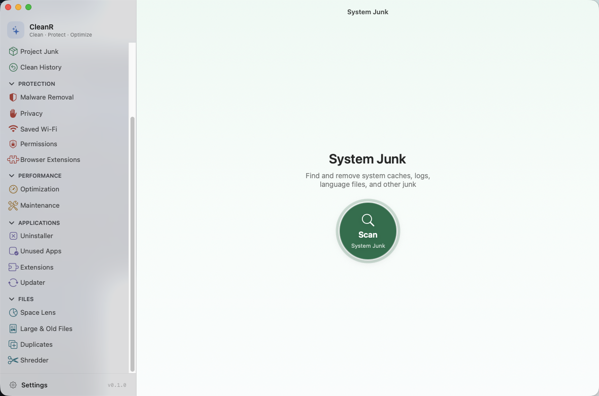
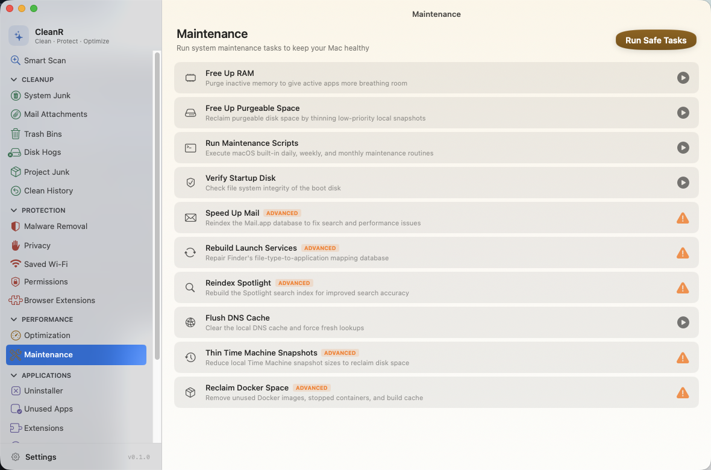
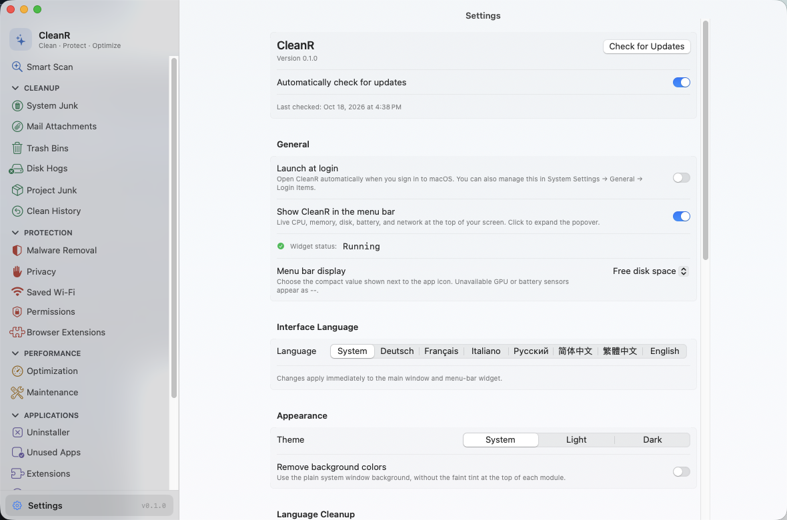

<p align="center">
  
</p>

<h1 align="center">CleanR</h1>

<p align="center">
  <strong>The source-available Mac cleaner, optimizer, and malware scanner.</strong><br>
  Created and licensed by <strong>Apex Studio LLC</strong>. A proprietary, no-cost-for-personal-use alternative to CleanMyMac, built with Swift 6 and SwiftUI.
</p>

<p align="center">
  <strong>English</strong> | <a href="README.zh-CN.md">简体中文</a> | <a href="README.zh-Hant.md">繁體中文</a> | <a href="README.de.md">Deutsch</a> | <a href="README.fr.md">Français</a> | <a href="README.ru.md">Русский</a>
</p>

<p align="center">
  <a href="https://github.com/coldrazer/CleanR/stargazers"></a>
  <a href="https://github.com/coldrazer/CleanR/releases/latest"></a>
  
  
  
  
  
  
</p>

<p align="center">
  
</p>

<p align="center">
  <a href="#screenshots">Screenshots</a> · <a href="#features-at-a-glance">Features</a> · <a href="#installation">Installation</a> · <a href="#how-cleanr-compares">Comparison</a> · <a href="#architecture">Architecture</a> · <a href="#contributing">Contributing</a>
</p>

<p align="center">
  <strong>Install with Homebrew</strong> (tap, until the cask is merged into homebrew-core):
</p>

```bash
brew tap coldrazer/cleanr && brew install --cask cleanr
```

<p align="center">
  Or grab the <a href="https://github.com/coldrazer/CleanR/releases/latest">latest DMG</a>. It is notarized by Apple, so it just opens, no right-click, no warnings, no Terminal.
</p>

---

## Why CleanR?

A full-featured Mac cleaner should not cost a yearly subscription or ask you to trust a black box with deep access to your files. CleanR gives you the whole toolkit with source available for inspection.

- **No cost for personal use.** No subscription, no in-app purchases, no "upgrade to Pro", no nag screens. Strict proprietary license: CleanR may not be sold or redistributed.
- **Zero telemetry.** No analytics, no crash reporter, no trackers, no server to phone home to. And you do not have to take our word for it, [verify it yourself](#verify-no-telemetry-yourself) in two commands.
- **Every major CleanMyMac tool, in one app.** 22 modules across cleanup, protection, performance, applications, and disk insight, plus a menu-bar widget.
- **Safe by design.** Trash-first deletion, a protected-paths blocklist, symlink and TOCTOU guards, and a `SafetyGuard` that validates every path. It is built to never lose your data.
- **Signed builds and inspectable source.** Official signed builds are verified by your Mac at launch, and the source is available to audit under the strict license terms.

---

## Screenshots

<table>
<tr>
<td width="50%" valign="top">

<p align="center"><strong>Smart Scan</strong> — one click checks junk, threats, performance, apps, and large files before anything is touched.</p>
</td>
<td width="50%" valign="top">

<p align="center"><strong>System Junk</strong> — caches, logs, language files, and other reclaimable space, reviewed item by item.</p>
</td>
</tr>
<tr>
<td width="50%" valign="top">

<p align="center"><strong>Maintenance</strong> — built-in macOS upkeep tasks, with advanced tasks clearly marked before they run.</p>
</td>
<td width="50%" valign="top">

<p align="center"><strong>Settings</strong> — appearance, language, menu-bar widget, and exclusions. No account, no telemetry toggles to hunt for.</p>
</td>
</tr>
</table>

---

## Features at a glance

<table>
<tr>
<td width="33%" valign="top">

### 🧹 Cleanup
- **Smart Scan** (one click)
- **System Junk** (16+ categories)
- **Mail Attachments**
- **Trash Bins**
- **Project Junk** (build folders)
- **Disk Hogs** (Docker, simulators)
- **Clean History** (one-click Restore)

</td>
<td width="33%" valign="top">

### 🛡️ Protection
- **Malware Removal**
- **Privacy** (browsers)
- **Browser Extensions**
- **Saved Wi-Fi**
- **Permissions Overview**

</td>
<td width="33%" valign="top">

### ⚡ Performance
- **Optimization** (login items)
- **Maintenance** (system tasks)

</td>
</tr>
<tr>
<td width="33%" valign="top">

### 📦 Applications
- **Uninstaller** (+ Reset to Defaults)
- **Unused Apps**
- **Extensions** (panes, plug-ins)
- **Updater**

</td>
<td width="33%" valign="top">

### 🗂️ Files
- **Space Lens** (disk treemap)
- **Large & Old Files**
- **Duplicates** (+ Consolidate)
- **Shredder**

</td>
<td width="33%" valign="top">

### 📊 Menu Bar
- Live CPU / memory / disk / battery
- Network, uptime, swap
- Actionable recommendations

</td>
</tr>
</table>

---

## Features in detail

### 🧹 Cleanup
| Module | What it does |
|--------|------------|
| **Smart Scan** | One click runs cleanup, protection, and performance modules together with live progress, then shows exactly what it freed per module |
| **System Junk** | 16+ scan categories: user and system caches, logs, language files, broken preferences, broken login items, document versions, iOS backups, Xcode junk, package-manager / IDE / AI-tool caches, deleted-user leftovers, and **Universal Binary thinning** (finds fat Mach-O binaries carrying both arm64 and x86_64 and rewrites them to your native arch via `lipo`, honoring Cancel) |
| **Mail Attachments** | Finds cached attachments from Apple Mail, Outlook, and Spark |
| **Trash Bins** | Empties the Trash across every location, including external drives |
| **Project Junk** | Finds regenerable build folders across your projects: `node_modules`, `.next`, `dist`, Rust and Maven `target`, Gradle `build`, Python virtualenvs, and CocoaPods `Pods`. A folder only counts when the files next to it confirm the project type, and `dist` and `Pods` only when your `.gitignore` names them. Everything goes to the Trash |
| **Disk Hogs** | Shows how much space Docker and Xcode simulators take. Prunes stopped containers, dangling images, and dangling build cache (each behind a confirmation), and deletes unavailable simulators and old simulator runtimes. Docker volumes and the newest runtime for each platform are never touched |
| **Clean History** | Lists your recent cleans (the last 30 days, up to 20) and puts a whole clean back from the Trash in one click. The history stays on your Mac in `~/Library/Logs/CleanR/clean-history.json`, readable only by your user account, and is never sent anywhere |

### 🛡️ Protection
| Module | What it does |
|--------|------------|
| **Malware Removal** | Signature-based scanning at 3 depths (Quick / Balanced / Deep): launch agents and daemons, browser extensions, and known adware/malware patterns (curated list, not an antivirus, and it says so) |
| **Privacy** | Cleans Safari, Chrome, and Firefox history, cookies, and cache, with time filters. Safari **bookmarks are never touched** |
| **Browser Extensions** | Lists the extensions installed in Safari, Chrome, Brave, Edge, Arc, and Firefox. Chromium and Firefox extensions you installed yourself can go to the Trash while that browser is closed; ones installed by policy or by the browser itself are shown but left alone. Safari extensions link to Safari's settings |
| **Saved Wi-Fi** | Lists your preferred wireless networks and forgets the ones you pick |
| **Permissions Overview** | A read-only, by-app view of which privacy (TCC) grants each app holds, the angle System Settings does not give you. Every action deep-links to System Settings, which owns the toggles |

### ⚡ Performance
| Module | What it does |
|--------|------------|
| **Optimization** | Manage login items and launch agents with per-item enable/disable |
| **Maintenance** | System tasks: free RAM, run maintenance scripts, verify the startup disk, rebuild Launch Services, reindex Spotlight, flush DNS, thin Time Machine snapshots. Tasks are tagged by severity, "Run Safe Tasks" is sequential, and the admin password is asked **once** |

### 📦 Applications
| Module | What it does |
|--------|------------|
| **Uninstaller** | A pattern-matching engine that finds every associated file across 17+ Library subdirectories (including apps nested in vendor subfolders). Complete removal, **Reset to Defaults** (wipe an app's caches and preferences while keeping the app), and unused-app detection |
| **Unused Apps** | Finds apps you have not opened in 3, 6, or 12 months, using Spotlight's last-used date, sorted by size. Running apps are never listed, and when Spotlight has no usage data it says so instead of guessing. One click hands an app to the Uninstaller |
| **Extensions** | Review third-party preference panes, Internet Plug-Ins, and Safari extensions. User-installed panes and plug-ins can go to the Trash |
| **Updater** | Checks installed apps for updates via their own Sparkle appcast feeds (reads version info only, sends nothing about you) |

### 🗂️ Files
| Module | What it does |
|--------|------------|
| **Space Lens** | Squarified-treemap visualization of disk usage with drill-down navigation |
| **Large & Old Files** | Finds files over 50 MB, sorted by size and last access date |
| **Duplicates** | Progressive detection (size grouping, partial SHA-256, full hash, inode verification), plus a **Consolidate** mode that reclaims space with APFS copy-on-write clones without deleting a single copy |
| **Shredder** | Secure file erasure with standard, permanent, and secure-overwrite modes |

### ⌨️ Keyboard shortcuts

| Shortcut | Action |
|----------|--------|
| **⌘R** | Start a scan in the current module |
| **⌘K** | Clean the current selection (when results are showing) |
| **⌘1 to ⌘9** | Jump to the first nine sidebar modules |
| **⌘,** | Open Settings |

---

## How CleanR compares

|  | CleanR | CleanMyMac | Pearcleaner | PureMac | OnyX | Mole |
|---|:---:|:---:|:---:|:---:|:---:|:---:|
| **Price** | Free | $39.95/yr | Free | Free | Free | Free (CLI) |
| **License** | Proprietary | Proprietary | ✅ Fair-code | ✅ MIT | Proprietary | ✅ MIT |
| **Telemetry** | ❌ None | ⚠️ Yes | ❌ None | ❌ None | ❌ None | ❌ None |
| **Native GUI app** | ✅ | ✅ | ✅ | ✅ | ✅ | ❌ CLI (paid GUI separate) |
| **Smart Scan (one-click)** | ✅ | ✅ | ❌ | ➖ Partial | ❌ | ➖ Interactive CLI |
| **System Junk (16+ categories)** | ✅ | ✅ | ➖ | ✅ | ➖ Limited | ✅ |
| **Universal Binary thinning** | ✅ | ✅ | ❌ | ❌ | ❌ | ❌ |
| **Malware scanner** | ✅ | ✅ | ❌ | ❌ | ❌ | ❌ |
| **Browser privacy cleaner** | ✅ | ✅ | ❌ | ❌ | ➖ | ❌ |
| **Uninstaller with leftover detection** | ✅ | ✅ | ✅ Focus | ❌ | ❌ | ✅ |
| **Duplicate finder (+ consolidation)** | ✅ | ➖ | ❌ | ❌ | ❌ | ❌ |
| **Disk treemap visualizer** | ✅ | ❌ | ❌ | ❌ | ❌ | ➖ Analyzer |
| **Menu bar system monitor** | ✅ | ✅ Menu | ❌ | ❌ | ❌ | ❌ |
| **Maintenance scripts** | ✅ | ✅ | ❌ | ❌ | ✅ Strong | ➖ |
| **Notarized by Apple** | ✅ | ✅ | ✅ | ✅ | ✅ | N/A |
| **macOS version** | 14+ | 13+ | 13+ | 13+ | varies | varies |

> CleanMyMac is a great product, and the people who want a polished, supported experience should happily pay for it. CleanR is for everyone who would rather inspect the source and pay no subscription.

---

## Interface languages

Choose System, Deutsch, Français, Русский, 简体中文, 繁體中文, or English in Settings → Interface Language. German, French, and Traditional Chinese translate static interface strings; interpolated messages retain the English wording and plural rules for now (Traditional Chinese falls back to Simplified). The main window and menu-bar widget share the language preference.

## Installation

### Homebrew

CleanR ships a cask in this repository (`Casks/cleanr.rb`) and a tap that is kept in sync with every release, so install it from the tap:

```bash
brew tap coldrazer/cleanr && brew install --cask cleanr
```

Once the cask is merged into [homebrew-core](https://github.com/Homebrew/homebrew-cask) the tap is no longer needed and plain `brew install --cask cleanr` works; the app's own update check covers both cases.

It is notarized by Apple, so it launches from Spotlight or Applications with no warnings and no extra steps.

<details>
<summary><strong>Other ways to install</strong> (one-line script, DMG, build from source)</summary>

<br>

**One-line installer**

```bash
curl -fsSL https://raw.githubusercontent.com/coldrazer/CleanR/main/scripts/install.sh | bash
```

Downloads the latest DMG, verifies its code signature and Gatekeeper assessment, and installs the app to `/Applications`. Read the script first if you would rather not pipe it straight into a shell: it is in this repository at [scripts/install.sh](scripts/install.sh).

**DMG download**

Grab the latest DMG from [Releases](https://github.com/coldrazer/CleanR/releases/latest) and drag CleanR to your Applications folder.

**Build from source**

```bash
git clone https://github.com/coldrazer/CleanR.git
cd CleanR
swift build
swift test                     # run the full 1,088-test suite
bash scripts/build-dmg.sh      # build a local DMG (unsigned)
```

Requires the Swift 6 toolchain (Xcode 16+).

**Homebrew core?**

The cask currently lives in this project's own tap (`coldrazer/cleanr`). A pull request to add it to homebrew-core is on the roadmap; until that merges, `brew install --cask cleanr` without the tap fails with `Error: Cask 'cleanr' is unavailable`.

</details>

### Granting Full Disk Access

A few modules (Mail Attachments, Privacy, Malware) need Full Disk Access to scan protected areas:

1. Open **System Settings, Privacy & Security, Full Disk Access**
2. Click **+** and add **CleanR.app**
3. Restart CleanR

### Uninstalling

Homebrew install:

```bash
brew uninstall --zap --cask cleanr
```

DMG or manual install (also handles a Homebrew install):

```bash
curl -fsSL https://raw.githubusercontent.com/coldrazer/CleanR/main/scripts/uninstall.sh | bash
```

Both remove CleanR plus its preferences, caches, logs, and database under `~/Library`.

---

## Signed, notarized, and yours to trust

CleanR is code-signed with an Apple **Developer ID** and **notarized by Apple**. That matters more for a cleaning app than for almost anything else you install, because you are about to give it deep access to your files, and you deserve to know that what runs on your Mac is genuinely ours and untampered with. All of this is enforced by your own Mac, not just promised by us:

- **Apple has scanned it.** Every release is submitted to Apple and checked for malware before it ships.
- **It cannot be tampered with.** The signature is a cryptographic seal over every file; change a single byte and macOS refuses to open it.
- **It is provably from us.** The signature is tied to our Apple Developer identity, so no one else can ship something your Mac accepts as CleanR.
- **It just works.** No Gatekeeper warnings, no right-click-to-open, no Terminal.

Put together with source available for inspection, this is a chain of trust you do not take on faith: you can inspect the code, Apex Studio LLC signs official releases, Apple verifies them, and your Mac re-checks the seal every time you open the app.

### Verify no telemetry yourself

Do not take our word for it. Both the source and the running process are checkable.

**1. Search the source for networking APIs**

```bash
rg -n 'URLSession|NSURLConnection' Sources --glob '*.swift'
```

You should only ever see two network paths, both optional and both read-only:

- `Sources/CleanRKit/UpdateChecker.swift`: the optional CleanR update check (turn it off in Settings)
- `Sources/CleanR/Modules/Updater/UpdaterModule.swift`: the user-driven check of *other apps'* Sparkle feeds when you open the Updater

There is no analytics, crash reporter, or tracker SDK anywhere in the codebase.

**2. Watch the live process**

```bash
lsof -i -P -n | grep -i 'CleanR\|CleanR\|CleanR' || echo "no network sockets"
```

Expected: no established connections while you are only cleaning locally. Little Snitch or LuLu make the same check visual.

**3. Inspect the binary you actually installed**

The source and the signed binary are different artifacts, so the strongest check runs against the app on your disk, not this repo. After `brew install --cask cleanr`:

```bash
APP="/Applications/CleanR.app/Contents/MacOS/CleanR"

# Networking classes the binary imports (only URLSession appears):
nm -u "$APP" | grep -iE 'URLSession|NWConnection|CFSocket' | sort -u

# Every URL compiled into the binary (only the two update endpoints are fetched):
strings -a "$APP" | grep -iE 'https?://' | sort -u
```

Expected: the only networking class is `_OBJC_CLASS_$_NSURLSession`, and the only fetch endpoints are `api.github.com/repos/coldrazer/CleanR/releases/latest` and `formulae.brew.sh/api/cask/cleanr.json`. The other `github.com/coldrazer/CleanR` links and the `buymeacoffee.com/cleanus` support link just open in your browser. No trackers, no analytics hosts, nothing else. Re-run it after any update; it always describes the exact build you are running.

Note: on a non-sandboxed Developer ID app like this one, network access is not gated by an entitlement, so this symbol and string inspection, not `codesign --entitlements`, is the real check. The same guard runs in CI on every change ([`scripts/check-network-surface.sh`](scripts/check-network-surface.sh)).

---

## Architecture

```
CleanR
├── CleanR          Main SwiftUI app (22 modules)
├── CleanRKit       Shared framework (models, constants, protocols)
├── CleanRHelper    XPC privileged helper (LaunchDaemon for root ops)
└── CleanRMenu      Menu-bar monitor (independent process)
```

### Tech stack

| Layer | Technology |
|-------|-----------|
| Language | Swift 6 with strict concurrency |
| UI | SwiftUI + AppKit hybrid |
| Concurrency | Actors, TaskGroup, async/await, `@Sendable` |
| Database | GRDB.swift (SQLite) with WAL mode |
| File scanning | `URLResourceKey` prefetching on APFS |
| Incremental updates | FSEvents with historical replay |
| Privileged ops | SMAppService + NSXPCConnection |
| System stats | Mach APIs (`host_processor_info`, `vm_statistics64`, `proc_pidinfo`) |

### Safety model

CleanR is designed to **never cause data loss**:

- **Protected-paths blocklist**: `/System`, `/usr`, `/bin`, `/sbin`, and Apple system apps are untouchable, with macOS firmlinks canonicalized so symlink-redirect detection does not false-positive on legitimate system paths
- **Pre-scan cleanability filter**: items the current process could not trash (root-owned children of system caches, data-vaulted `~/Library/Caches/com.apple.*` dirs) are dropped at scan time so they never appear as cleanable
- **Trash-first deletion**: every removal goes to the Trash by default, and a dry-run mode previews without touching anything
- **TOCTOU prevention**: symlinks are re-resolved immediately before deletion
- **Excluded Folders**: pick folders in Settings that scans skip entirely, and `SafetyGuard` additionally refuses to delete anything under them
- **Chunked, cancellable cleanup**: large selections split into 5k-item chunks honoring cancellation between chunks, and scans return to idle within about a second when you hit Cancel
- **In-app activity log**: every error during a clean is logged with its full path, viewable and copyable from the post-clean screen, auto-pruned after 30 days
- **Kernel-enforced XPC gate**: the privileged helper uses `NSXPCListener.setCodeSigningRequirement` so the kernel itself rejects any connection whose code signature does not match the app's identifier and team

---

## Tests

```bash
swift test
```

The XCTest suite has **715 tests** and treats `SafetyGuard` and `CleaningEngine` (the death-and-life files) as must-be-perfect: adversarial coverage of symlinks, path traversal, NULL bytes, SIP, protected apps, file-count caps, TOCTOU, and idempotence, plus integration coverage of dry-run / trash / permanent cleaning, the scan state machine, every System Junk category, the treemap math, the uninstaller matching engine, duplicate detection, appcast parsing, and full end-to-end fixture-to-clean cycles. Fixtures (`withTempHome`, `withFakeApp`, `withFakePlist`) keep every test off your real home directory.

---

## Contributing

CleanR is proprietary software created and licensed by **Apex Studio LLC**.
External contributions are accepted only when Apex Studio LLC has agreed in
writing in advance. Do not fork, copy, modify, or redistribute CleanR in order
to prepare a contribution. If Apex Studio LLC invites a contribution, the
contributor must agree that Apex Studio LLC may use and license the
contribution as part of CleanR under the terms stated in [LICENSE](LICENSE).

## License

**Strict Proprietary — no sale, no distribution.**

CleanR was created by **Apex Studio LLC** and is licensed by Apex Studio LLC.
See [LICENSE](LICENSE). Personal, non-commercial use of an unmodified copy
obtained from an official Apex Studio LLC channel is permitted. Selling,
sublicensing, sharing, publishing, mirroring, redistributing, or otherwise
distributing CleanR is prohibited without prior written authorization from
Apex Studio LLC.

Third-party components remain under their own licenses. See
[NOTICE.md](NOTICE.md) and the license texts in [LICENSES/](LICENSES/).

## Acknowledgments

Inspired by the open-source Mac utility community:

- [Pearcleaner](https://github.com/alienator88/Pearcleaner): app uninstaller patterns
- [Mole](https://github.com/tw93/Mole): cleanup categories
- [Tencent Lemon Cleaner](https://github.com/Tencent/lemon-cleaner): modular architecture
- Squarified Treemap algorithm by Bruls, Huizing, and van Wijk (2000)

## Support and sponsors

CleanR is free and stays free: no paid tier, no ads, no tracking. If it saved you from a cleaner subscription, you can [buy me a coffee ☕](https://buymeacoffee.com/cleanus). It keeps the releases signed, notarized, and coming.

### Sponsor slot

CleanR has **one** sponsor slot, shown right here. Around 9,000 people visit this repository every month, and the app has been downloaded more than 76,000 times, mostly by developers and Mac power users.

- **One sponsor at a time**, so your name is not lost in a wall of logos.
- **Vetted.** Developer tools, privacy and security products, and Mac apps that respect their users. No cleaners or "optimizers", no crypto, no affiliate VPN deals, nothing that tracks people.
- **Never inside the app.** CleanR has no ads and no telemetry, and no sponsor changes that.

<p align="center">
  <strong>This spot is open.</strong> <a href="mailto:iliya.mi78@gmail.com?subject=Mac%20Sai%20sponsor">Become the sponsor →</a>
</p>

## Star History

<p align="center">
  <a href="https://www.star-history.com/?repos=cleanr%2FCleanR&type=date&legend=top-left">
    <picture>
      <source media="(prefers-color-scheme: dark)" srcset="https://api.star-history.com/chart?repos=coldrazer/CleanR&type=date&theme=dark&legend=top-left&sealed_token=U-awhgge-qJwqcwRMpeYAooRYIriMPXuNrQErHZuAQsbmKYoo3D7oum-5zvqFjZlP77FXRFg56nh-1Ie9oWSBAPeS7-NUe70kSI-3XJ_Ce97vHA0OQcqEKhE0STA4FhfJ-bkteG7lb2xAVJWcLPtIJalJjJuhE2nrgA4rrcQbs6cJPk2-sbuJw76SARx" />
      <source media="(prefers-color-scheme: light)" srcset="https://api.star-history.com/chart?repos=coldrazer/CleanR&type=date&legend=top-left&sealed_token=U-awhgge-qJwqcwRMpeYAooRYIriMPXuNrQErHZuAQsbmKYoo3D7oum-5zvqFjZlP77FXRFg56nh-1Ie9oWSBAPeS7-NUe70kSI-3XJ_Ce97vHA0OQcqEKhE0STA4FhfJ-bkteG7lb2xAVJWcLPtIJalJjJuhE2nrgA4rrcQbs6cJPk2-sbuJw76SARx" />
      
    </picture>
  </a>
</p>

<p align="center">
  <strong>CleanR is free software built by the community, for the community.</strong><br>
  If it saved you from a subscription, a ⭐ helps others find it, and a <a href="https://buymeacoffee.com/cleanus">coffee ☕</a> keeps it going.
</p>
